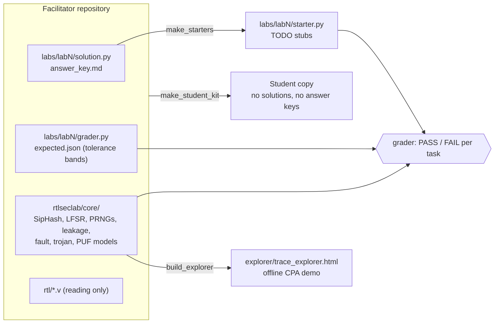
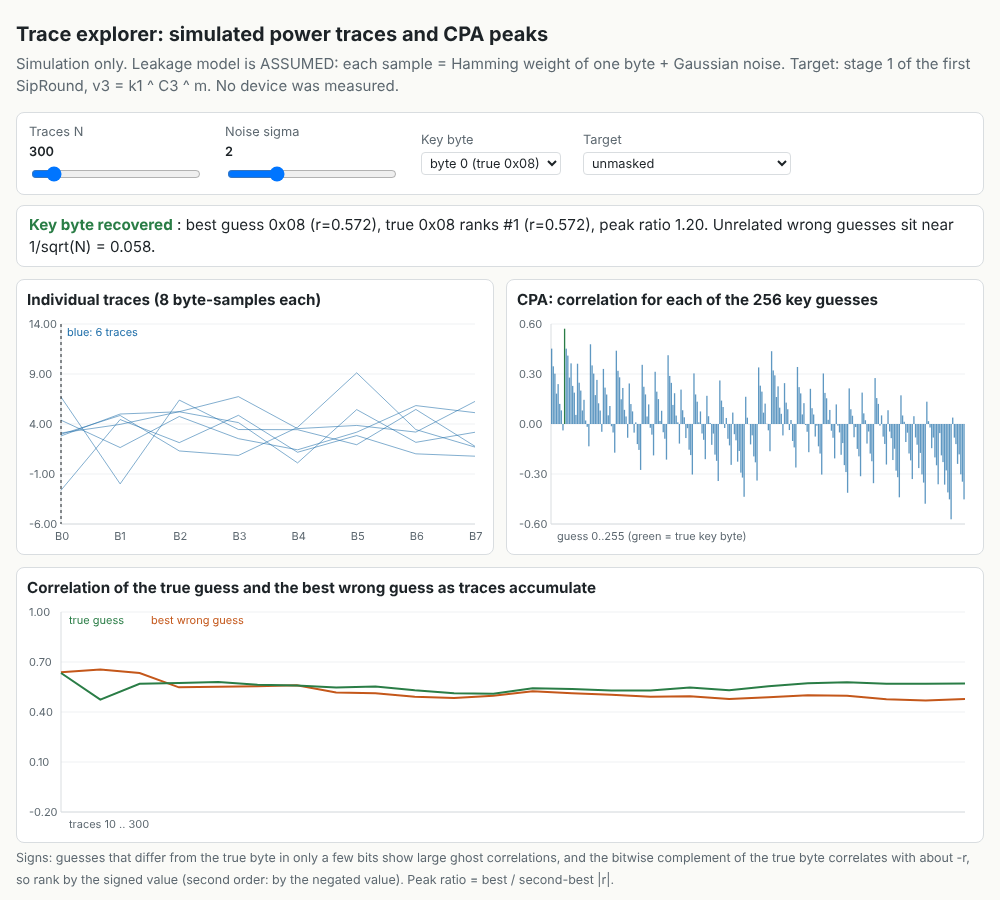

# RTL-Sec-Lab

> **Status: frozen, 2026-11-23.** No new labs are planned. **Not done:** the kit has never been run with
> students, and no one has yet worked through it from the starters alone; the lab timings are a plan, not a
> record. Running it once with a small group is the step that would show where the handouts fail.

**A three-hour, six-lab workshop kit on the hardware security of a small keyed frequency-hop engine: breaking weak generators, power analysis, masking, fault injection, trojans and PUFs. Every lab has a starter, a reference solution and a deterministic auto-grader.**

[](https://github.com/Kavin-Re/RTL-Sec-Lab/actions/workflows/ci.yml)


> **Scope.** Everything is simulation of the author's own design. There is no device, no measured
> trace, no radio and no real exploit. Leakage, fault, trojan and PUF behaviour come from simple
> assumed models, and each handout says so. The Verilog in `rtl/` is for reading; the kit does not
> simulate it.
>
> **Labs 3 and 4 use uniformly random messages.** The real engine hashes a slot counter that counts up. With
> consecutive counter values, the reference attack of Lab 3 recovers only 1 of 8 key bytes of each key half
> at 300 traces (2 of 8 at 70,000), against 8 of 8 with random messages. The labs teach the method; they are
> not an end-to-end break of a counter-mode engine. Details: [Limitations](#limitations) and
> [`docs/known_issues.md`](docs/known_issues.md).

> **This repository contains the solutions.** It is the facilitator's copy. Give students the
> export described under [Running a workshop](#running-a-workshop).

## The labs

The running example is a hop engine that outputs `SipHash-2-4(key, slot) mod 13`, contrasted with
the 16-bit LFSR it replaces.

| # | Lab | What students build | What the reference solution shows |
|---|---|---|---|
| 1 | Breaking the 16-bit LFSR hop generator | Candidate elimination over all 65,535 states | State pinned down after 8.33 hops on average; each hop shrinks the candidate set about 4x, not 13x |
| 2 | The PRNG graveyard | LCG state recovery, Mersenne Twister cloning, a GF(2) solver for xorshift, a context predictor | LCG-24 predicted after 7 hops, xorshift-32 after 9, MT19937 after 624 raw 32-bit outputs; keyed schedules stay at chance |
| 3 | Correlation power analysis | Hamming-weight hypotheses, Pearson correlation, two-stage divide and conquer with carry | Full 128-bit key from 200 simulated traces at sigma = 2; trace count grows 4x when the noise doubles |
| 4 | Masking and its limits | 2-share Boolean masking, first- and second-order CPA, fixed-vs-random Welch t-test | First-order attack fails on masked traces, second-order succeeds with more traces; a share-recombining register undoes the masking |
| 5 | Fault injection and the cost of TMR | Majority voter, exact and Monte Carlo TMR failure probability, area trade-off | State-only TMR costs about 53 % in the gate-equivalent proxy, full-engine TMR about 200 %; a common-mode flip passes the voter |
| 6 | Trojan detection and a PUF key source | Chi-square alarm, CUSUM, PUF uniqueness and reliability, fuzzy extractor | CUSUM flags a 3.1 % output bias after 14 windows on average, a single-window alarm after 24; a layout gradient ruins PUF uniqueness until it is removed |

Labs 1 to 6 are budgeted at 25, 20, 30, 25, 20 and 25 minutes. The numbers in the right-hand column
are the deterministic output of `python -m rtlseclab.check` with the default seeds.



## Quick start

```bash
git clone https://github.com/Kavin-Re/RTL-Sec-Lab.git && cd RTL-Sec-Lab
python -m pip install -r requirements.txt       # numpy

python -m rtlseclab.check                # every solution through every grader
python -m rtlseclab.check --starters     # ...and confirm every starter fails cleanly
python labs/lab3_power_cpa/grader.py labs/lab3_power_cpa/solution.py
```

Expected last line of the check: `KIT CHECK: 39/39 solution tasks PASS across 6 labs`. That count says the
reference solutions pass their own graders, both written by the same author. It is a consistency check of the
kit, not evidence that the labs teach well or that the models match real hardware.

A grader run looks like this:

```console
$ python labs/lab3_power_cpa/grader.py labs/lab3_power_cpa/solution.py
PASS  T3 stage-1 CPA recovers k1  [5/5 keys, peak r = 0.580]
PASS  T4 stage-2 CPA recovers k0 (carry, low byte first)  [5/5 keys, k0 recovered given k1]
PASS  T5 success_rate vs noise and N  [success: s2/N50 0.00, s2/N200 1.00, s4/N800 1.00]
PASS  T6 min_traces scales with sigma^2  [min traces: sigma 2 -> 200, sigma 4 -> 800 (x4.0)]
...
SUMMARY: 7/7 PASS
```

`explorer/trace_explorer.html` is a single offline page for labs 3 and 4: it runs the CPA in the
browser on embedded simulated traces and shows why masking defeats the first-order attack.



## Running a workshop

1. Read [`docs/facilitator_guide.md`](docs/facilitator_guide.md): setup, a minute-by-minute plan,
   common mistakes per lab, and the list of things the kit does not model.
2. Export the student copy and distribute that, not this repository:

   ```bash
   python -m rtlseclab.tools.make_student_kit        # -> dist/rtl-sec-lab-student/
   ```

   It contains the handouts, starters, graders, the models, the RTL and the explorer. It leaves
   out `solution.py`, `answer_key.md`, the facilitator guide and the kit self-tests.
3. Students fill in the TODOs of `labs/labN_*/starter.py` and grade themselves with
   `python labs/labN_*/grader.py labs/labN_*/starter.py`.

**The graders are for self-checking, not for assessment.** They compare student code against
reference models in `rtlseclab/core/`, which therefore ship with the student copy; a student who
wants to can call those directly. The seeds are fixed; `RTLSECLAB_SEED_SHIFT=k` shifts them if you
suspect hard-coded outputs. And because this repository is public, the solutions are one search
away. See the note on publishing below.

## How the kit checks itself

| Check | Command |
|---|---|
| All 39 solution tasks pass; all starters fail with "not implemented yet" and never crash the grader | `python -m rtlseclab.check --starters` |
| Starters are regenerated from the solutions and in sync | `python -m rtlseclab.tools.make_starters --check` |
| Mutation tests: six deliberately broken solutions each fail the intended task | `python -m unittest tests.test_graders` |
| Tolerance bands hold for 20 different seed streams | `python tests/test_robustness.py 20 4` (several minutes) |
| The explorer's JavaScript CPA agrees with a NumPy CPA on the same data | `python tests/test_explorer.py` (needs Playwright; rewrites `tests/screens/`) |

## Repository layout

```
labs/labN_*/     handout.md  starter.py  solution.py  grader.py  expected.json  answer_key.md
rtlseclab/core/  the models (each file names the FHSS-Link file it was copied from)
rtlseclab/       grading.py (harness), check.py (kit check), tools/ (starters, student kit, explorer)
rtl/             hop_lfsr.v, hop_keyed.v (reading only)
explorer/        trace_explorer.html (generated from template.html)
docs/            facilitator_guide.md, MODEL_NOTES.md, known_issues.md
tests/           grader tests, explorer test, seed-robustness script
```

## Limitations

- **No measurements.** Power traces are Hamming weight or distance of one byte plus Gaussian
  noise: no alignment, jitter, glitches or coupling. Masking is modelled at share-byte level only.
- **The CPA labs use uniformly random 64-bit messages.** The real engine hashes a slot counter.
  With consecutive slots, the first-round attack of Lab 3 recovers only the key bytes aligned with
  counter bytes that change: 1 of 8 bytes of each key half at 300 traces and 2 of 8 at 70,000 in
  this model. The labs teach the method; they are not an end-to-end break of a counter-mode engine.
- **Faults are abstract bit flips** in a receiver-side register model. No physical mechanism, no
  datapath, voter or transmit-side faults.
- **Area figures are a gate-equivalent proxy** built from assumed cell areas, not synthesis results.
- **The Python hop model and `rtl/hop_keyed.v` are not bit-identical.** They share the SipHash
  digest but map it to a channel differently. See [`docs/MODEL_NOTES.md`](docs/MODEL_NOTES.md).
- **Trojan and PUF models are abstractions** and prove nothing about any real chip.
- Lab durations are the author's plan. This repository holds no record of the kit being run with an audience.
- No citations are included beyond named classic ideas. Look them up before quoting.

## Related projects

The models and RTL are copied from the silicon-security experiments in
[FHSS-Link](https://github.com/Kavin-Re/FHSS-Link) (each file carries an ORIGIN header) and made
standalone; nothing is imported from that repository. [HopBench](https://github.com/Kavin-Re/HopBench)
turns the attacks of labs 1 and 2 into a scoring benchmark.

## License

Copyright 2026 Kavin K K. Licensed under the [Apache License, Version 2.0](LICENSE); see also [NOTICE](NOTICE).

The hop-engine models in `rtlseclab/core/` are copied from the author's FHSS-Link repository (each file names its source), which is under the same licence.
